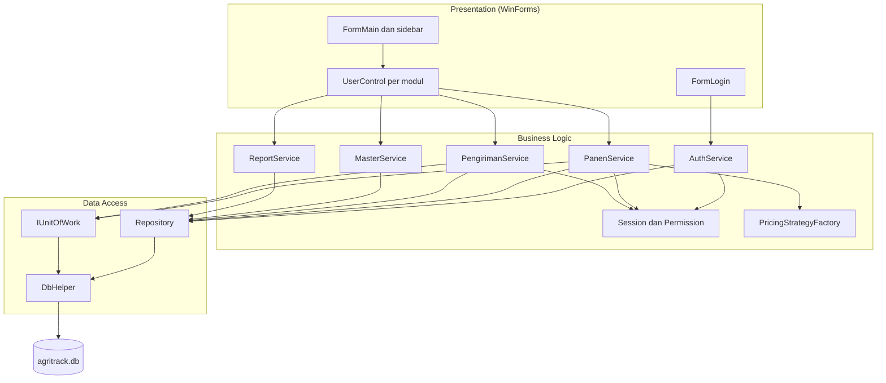
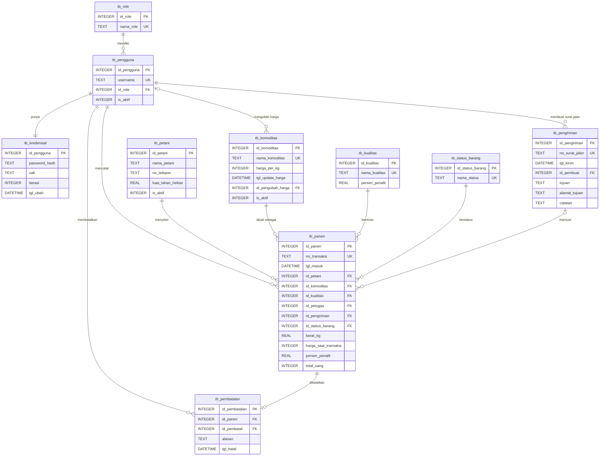

# AgriTrack

Aplikasi desktop offline untuk mengelola operasional pergudangan hasil bumi di Koperasi Unit Desa (KUD) atau pengepul lokal.

> **Status:** tahap perancangan selesai (PRD v1.4). Implementasi kode sedang/akan dikerjakan.
> Proyek Akhir Mata Kuliah Pemrograman Lanjut. Penulis: [Nama Mahasiswa]

## Latar Belakang

KUD dan pengepul umumnya masih mencatat setoran panen di buku besar. Akibatnya:

- catatan rentan rusak atau hilang,
- petugas sering salah menghitung berat timbangan dikali harga komoditas yang berubah tiap hari,
- stok yang masih di gudang tidak jelas dibanding yang sudah dikirim ke pabrik atau distributor,
- kesalahan input tidak bisa dikoreksi secara tertib dan tidak meninggalkan jejak audit,
- pengiriman tidak tercatat siapa pembuat surat jalannya dan ke mana tujuannya.

AgriTrack menyelesaikannya dengan mengotomatisasi perhitungan, mencatat setiap transaksi beserta koreksinya, dan menampilkan status barang secara real-time.

## Cara Kerja

1. Petani datang membawa hasil bumi.
2. Petugas Gudang memilih petani dan komoditas, lalu memasukkan berat timbangan dan kualitas. Sistem otomatis mengalikan berat dengan harga patokan hari itu.
3. Transaksi tersimpan dengan status **Di Gudang**.
4. Saat truk datang, Supir mencentang barang di aplikasi, mengetik tujuan, lalu membuat surat jalan. Status berubah menjadi **Dikirim**.

## Fitur

Aplikasi memakai satu jendela utama dengan sidebar yang memuat enam modul. Menu yang tampil mengikuti hak akses pengguna.

| Modul | Fungsi |
|---|---|
| Dashboard | Total petani aktif, stok gudang (kg), jumlah transaksi hari ini (tanpa transaksi Batal). Tombol backup database hanya untuk Admin |
| Master Petani | Daftarkan dan ubah petani (Admin dan Gudang). Penonaktifan hanya oleh Admin |
| Master Komoditas | Tambah komoditas dan perbarui harga patokan harian (Admin). Mencatat waktu dan pengguna yang terakhir mengubah harga. Tab Pengguna untuk akun, role, dan reset password |
| Setor Panen | Total dihitung otomatis secara real-time, peringatan bila harga belum diperbarui hari ini, validasi harga basi, daftar transaksi Di Gudang untuk pembatalan, dan opsi cetak nota |
| Manifest Pengiriman | Checklist barang Di Gudang. Supir mengetik tujuan (wajib) dan alamat tujuan (boleh kosong), lalu membuat surat jalan |
| Laporan Rekapitulasi | Tabel gabungan dengan filter rentang tanggal dan status barang, serta ekspor CSV |

Fitur pendukung (prioritas Seharusnya): cetak nota petani, ekspor CSV, backup database, dan manajemen pengguna.

### Hak Akses

| Permission | Admin | Gudang | Supir |
|---|---|---|---|
| LihatDashboard | Ya | Ya | - |
| KelolaMaster (komoditas, harga, nonaktifkan petani) | Ya | - | - |
| KelolaPetani (tambah dan ubah petani) | Ya | Ya | - |
| InputPanen | Ya | Ya | - |
| BatalkanPanen (semua transaksi Di Gudang) | Ya | - | - |
| BatalkanPanenSendiri (transaksi sendiri, hari yang sama, Di Gudang) | - | Ya | - |
| BuatSuratJalan (termasuk melihat manifest) | Ya | - | Ya |
| LihatLaporan dan ekspor CSV | Ya | - | - |
| BackupDb | Ya | - | - |
| KelolaPengguna | Ya | - | - |
| GantiPasswordSendiri | Ya | Ya | Ya |

Hak akses diperiksa di antarmuka (menu disembunyikan) dan di lapisan service (operasi ditolak).

### Aturan Bisnis Utama

- **Isolasi harga:** harga, penalti, dan total disimpan sebagai snapshot saat Simpan. Perubahan harga master tidak memengaruhi transaksi lama.
- **Panen basah:** penalti dibaca dari tabel kualitas (Basah = 10%) lalu diterapkan pada harga sebelum dikalikan berat. Total dihitung dengan `decimal` dan dibulatkan dengan `MidpointRounding.AwayFromZero`.
- **Harga harian:** bila harga komoditas belum diperbarui hari ini, petugas mendapat peringatan dan dapat melanjutkan setelah konfirmasi. Bila harga berubah saat form terbuka, petugas diminta konfirmasi total baru.
- **Pembatalan:** Admin dapat membatalkan semua transaksi di gudang, Gudang hanya transaksinya sendiri pada hari yang sama. Wajib beralasan, dan transaksi yang sudah dikirim atau dibatalkan tidak dapat dibatalkan lagi. Transaksi tidak pernah dihapus.
- **Surat jalan atomik:** semua barang terpilih berubah status dalam satu transaksi, atau tidak ada yang berubah. Surat jalan mencatat pembuatnya (Supir atau Admin).
- **Integritas data:** petani, komoditas, dan pengguna tidak pernah dihapus, hanya dinonaktifkan.
- **Penomoran:** nomor transaksi `TRX-YYMMDD-NNN` dan surat jalan `SJ-YYMMDD-NNN` dihitung dari nomor tertinggi termasuk transaksi Batal, sehingga nomor tidak dipakai ulang.

## Teknologi

- C# (.NET Framework atau .NET Core), Windows Forms
- SQLite lewat `System.Data.SQLite` (NuGet), tanpa server database
- Berjalan sepenuhnya offline, untuk satu instalasi pada satu komputer

## Arsitektur

Tiga lapisan: Presentation (WinForms, satu jendela dengan panel yang berganti), Business Logic (service), dan Data Access (repository). Service bergantung pada antarmuka dengan dependency injection manual di `Program.cs`.



Pola desain yang dipakai:

- **Strategy:** `IPricingStrategy` (Normal, Basah) untuk perhitungan harga.
- **Repository:** `IRepository` per tabel dan `IPanenRepository` untuk query khusus.
- **Unit of Work:** `IUnitOfWork` untuk transaksi atomik (penyimpanan panen, surat jalan, pembatalan).
- **Singleton:** `Session` untuk pengguna aktif, dengan `Authorize(permission)`.

## Skema Database

Sepuluh tabel, memenuhi 3NF dengan denormalisasi terkontrol. Seluruh kunci primer dan kunci asing bertipe INTEGER.



Catatan desain:

- Nomor cetak `TRX-YYMMDD-NNN` dan `SJ-YYMMDD-NNN` disimpan di kolom unik `no_transaksi` dan `no_surat_jalan`, bukan sebagai kunci primer.
- Nilai domain (role, kualitas, status barang) dirujuk lewat tabel referensi. Data awalnya diisi otomatis dengan ID yang sama dengan enum C#.
- Kolom snapshot (`harga_saat_transaksi`, `persen_penalti`, `total_uang`) sengaja disimpan agar transaksi lama tidak berubah.
- `tujuan` dan `alamat_tujuan` berupa teks bebas pada `tb_pengiriman`. Konsekuensinya, nama tujuan yang sama bisa tertulis berbeda dan tidak dikelompokkan otomatis di laporan. Ini diterima sebagai keterbatasan demi kesederhanaan.
- `id_pengubah_harga` pada `tb_komoditas` boleh kosong untuk data awal.
- Status Dikirim berarti `id_pengiriman` terisi dan sebaliknya (dijaga CHECK dua arah). Status Batal berarti ada satu baris di `tb_pembatalan` (dijaga service dalam satu transaksi).
- `PRAGMA foreign_keys = ON` dijalankan di setiap koneksi.

## Struktur Proyek (rencana)

```
AgriTrack/
├── AgriTrack.sln
├── AgriTrack/
│   ├── Models/        Pengguna, Petani, Komoditas, Panen, Pengiriman,
│   │                  Pembatalan, Kredensial, enum Permission, StatusBarang
│   ├── Data/          DbHelper, IRepository, IPanenRepository, PanenRepository,
│   │                  repository master, IUnitOfWork, SqliteUnitOfWork
│   ├── Pricing/       IPricingStrategy, NormalPricing, BasahPricing,
│   │                  PricingStrategyFactory
│   ├── Services/      AuthService, MasterService, PanenService,
│   │                  PengirimanService, ReportService
│   ├── Forms/         FormLogin, FormMain
│   ├── Controls/      UCDashboard, UCPetani, UCKomoditas,
│   │                  UCSetorPanen, UCManifest, UCLaporan
│   ├── Helpers/       Session, PasswordHasher, NotaPrinter,
│   │                  CsvExporter, BackupHelper
│   └── Program.cs
├── docs/              PRD, SRS, dokumentasi desain
└── README.md
```

## Menjalankan Proyek

Prasyarat: Windows, Visual Studio dengan workload ".NET desktop development".

1. Clone repo:
   ```bash
   git clone <url-repo>
   cd AgriTrack
   ```
2. Buka `AgriTrack.sln` di Visual Studio.
3. Restore paket NuGet (otomatis saat build). Paket utama: `System.Data.SQLite`.
4. Jalankan (F5).

Saat pertama dijalankan, aplikasi membuat berkas `agritrack.db`, mengisi tabel referensi, dan membuat satu akun awal untuk tiap role secara otomatis. Segera ganti password akun awal setelah login pertama.

> Berkas database dibuat otomatis, jadi tidak perlu di-commit. Tambahkan `*.db`, `bin/`, `obj/`, dan `.vs/` ke `.gitignore`.

## Di Luar Lingkup

Status pembayaran, pembayaran bertahap dan saldo utang, master tujuan pengiriman, penggunaan multi-komputer, retur setelah pengiriman, riwayat harga lengkap, log aktivitas master data, cetak dan koreksi surat jalan, pembatasan percobaan login dan timeout sesi, serta antarmuka untuk mengubah persentase penalti kualitas.

## Dokumentasi

- PRD (Product Requirements Document) v1.4
- SRS (Software Requirements Specification)
- Dokumentasi desain sistem: arsitektur, ERD, use case, activity, sequence, state, dan class diagram

Simpan salinannya di folder `docs/`.

## Checklist Pengerjaan

**Wajib**

- [ ] Database, `DbHelper`, dan data awal tabel referensi
- [ ] Login, hash password, `Session`, dan permission
- [ ] Master Petani (tambah dan ubah oleh Admin dan Gudang)
- [ ] Master Komoditas (harga, `tgl_update_harga`, `id_pengubah_harga`)
- [ ] Setor Panen (strategi harga, peringatan harga harian, validasi harga basi, snapshot)
- [ ] Pembatalan transaksi
- [ ] Manifest dan surat jalan (tujuan diisi manual)
- [ ] Dashboard
- [ ] Laporan dengan filter

**Seharusnya**

- [ ] Cetak nota petani
- [ ] Ekspor laporan CSV
- [ ] Backup database
- [ ] Manajemen pengguna (tambah akun, nonaktifkan, reset dan ganti password)

**Penutup**

- [ ] Pengujian dan finalisasi dokumen
